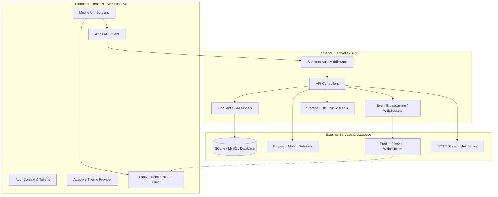
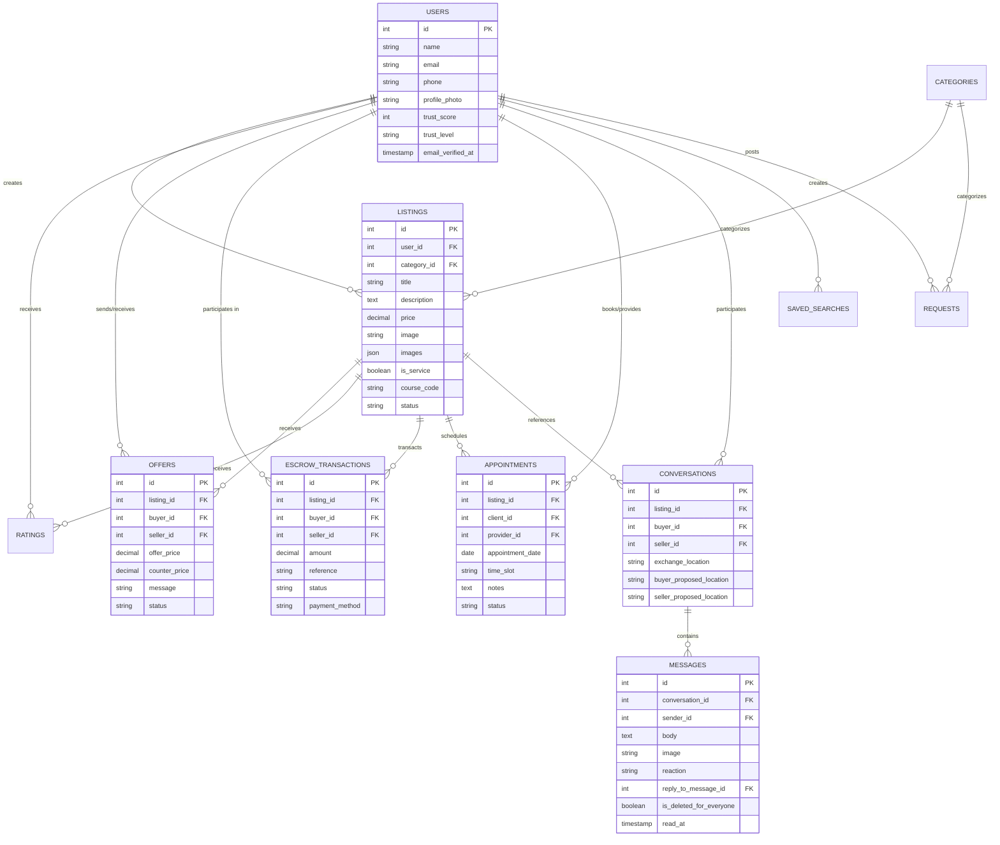
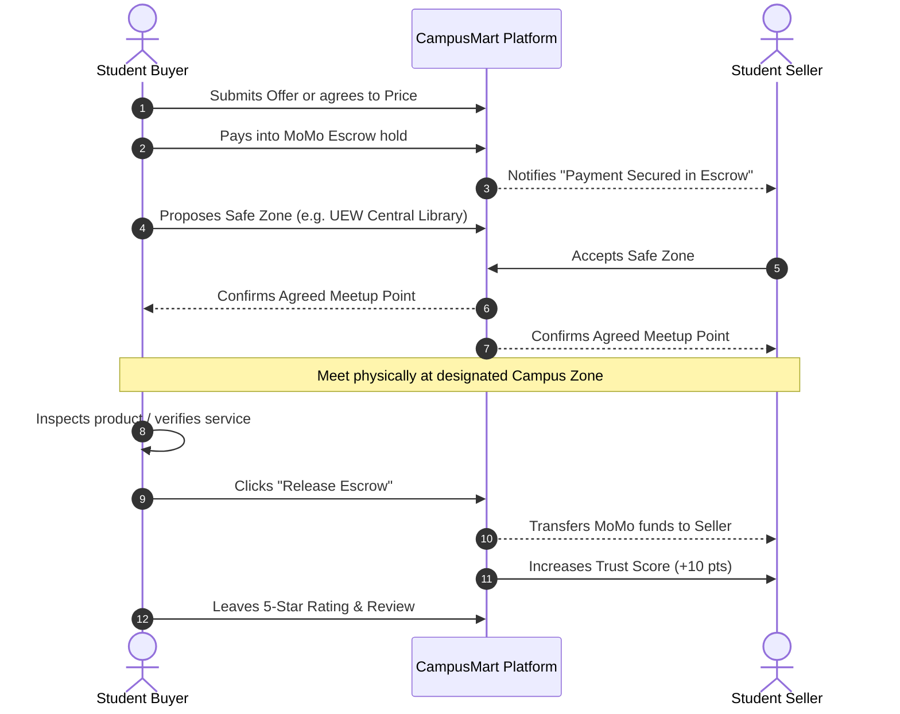

# 🛒 CampusMart (UEW Edition)

[](https://reactnative.dev/)
[](https://expo.dev/)
[](https://laravel.com/)
[](https://www.php.net/)
[](https://uew.edu.gh/)
[](LICENSE)

> **CampusMart** is a secure, hyper-local peer-to-peer campus marketplace and student services platform engineered specifically for tertiary institutions, featuring primary localization for the **University of Education, Winneba (UEW)** in Ghana.

---

## 📖 Table of Contents

- [The Problem & The Solution](#-the-problem--the-solution)
- [System Architecture](#-system-architecture)
- [Key Features](#-key-features)
  - [1. Verified Student Community](#1-verified-student-community)
  - [2. Marketplace & Academic Matching](#2-marketplace--academic-matching)
  - [3. MoMo Escrow Payment Engine](#3-momo-escrow-payment-engine-paystack)
  - [4. Service Appointment Booking](#4-service-appointment-booking)
  - [5. Real-Time Chat & Safe Meetup Zones](#5-real-time-chat--safe-meetup-zones)
  - [6. Price Offers & Interactive Negotiations](#6-price-offers--interactive-negotiations)
  - [7. Search Alerts & Student Request Board](#7-search-alerts--student-request-board)
  - [8. Unified Activity Hub & Dark Mode](#8-unified-activity-hub--dark-mode)
- [Tech Stack](#-tech-stack)
- [Repository Structure](#-repository-structure)
- [Database Schema & Models](#-database-schema--models)
- [API Reference](#-api-reference)
- [Local Setup & Installation](#-local-setup--installation)
  - [Prerequisites](#prerequisites)
  - [1. Backend Setup (Laravel 12)](#1-backend-setup-laravel-12)
  - [2. Frontend Setup (React Native / Expo)](#2-frontend-setup-react-native--expo)
- [Environment Configuration](#-environment-configuration)
- [Safe Campus Exchange Protocol](#-safe-campus-exchange-protocol)
- [Contributing](#-contributing)
- [License](#-license)

---

## 🎯 The Problem & The Solution

| Campus Challenge | How CampusMart Solves It |
| :--- | :--- |
| **Scammers & Impersonation:** Fraudsters infiltrate campus WhatsApp groups and unofficial buy/sell channels. | **Mandatory Institutional Verification:** Registrations require authenticated `@uew.edu.gh` student email addresses with signed verification links. |
| **Cash Handling Risks:** In-person cash handovers create robbery or counterfeit currency risks. | **Mobile Money (MoMo) Escrow:** Buyers pay via MTN MoMo / Telecel Cash / AT into escrow; funds are held safely until items are physically inspected and approved. |
| **Dangerous Meetup Locations:** Meetings at isolated hostels or off-campus areas lead to security threats. | **In-App Safe Meetup Zones:** Bilateral agreement protocol locking in monitored campus locations (e.g., UEW Central Library, North Campus Student Center). |
| **Lost Academic Materials:** Students struggle to find specific past questions, handouts, or reference books. | **Course Code Indexing:** Listings can be tagged with course codes (e.g., `ICT 231`, `EDC 111`) with instant search and keyword alerts. |
| **Unreliable Student Freelancers:** No accountability for campus tutors, hairdressers, or photographers. | **Service Appointments & Trust Scores:** Slot-based booking scheduler combined with verified algorithmic trust tiers (*Verified Student*, *Trusted Trader*, *Top Seller*). |

---

## 🏗 System Architecture

CampusMart operates as a modern decoupled client-server architecture:



---

## ✨ Key Features

### 1. Verified Student Community
* **Email Restriction:** Strictly accepts `@uew.edu.gh` email addresses, preventing non-students and external scammers from accessing the network.
* **Algorithmic Trust Score (0–100):**
  * `+30 points` Base score for verified institutional email.
  * `Up to 40 points` Calculated based on star reviews received (`(avg_rating / 5) * 40`).
  * `Up to 30 points` Earned for completed sales/transactions (1 point per successful sale, capped at 30).
* **Trust Badges:** Dynamic member badges (*New Member*, *Verified Student*, *Trusted Trader*, *Top Seller*).

### 2. Marketplace & Academic Matching
* **12 Campus-Specific Categories:**
  * 📚 Textbooks & Handouts
  * 💻 Electronics & Laptops
  * 👕 Clothing & Fashion
  * 🍱 Food & Drinks
  * 🪑 Hostels & Furniture
  * ✏️ Stationery & Drawing Kits
  * 🎓 Academic Tutoring
  * 📷 Photography & Videography
  * 🎨 Graphic Design & Printing
  * 💇 Hair, Nails & Beauty
  * 🚗 Student Shuttle & Transport
  * 📦 General / Other
* **Course Code Indexing:** Textbooks and revision materials can specify academic codes (e.g., `ICT 231`) for direct search filtering.
* **Media Gallery:** Support for up to 5 photos per listing with multi-image carousel preview.
* **Debounced Search & Budget Filters:** Instant 350ms debounced queries and price brackets (e.g., "Under GH₵ 50").

### 3. MoMo Escrow Payment Engine (Paystack)
* **Buyer Protection:** Instead of direct unverified transfers, buyer funds are placed in a secure escrow hold upon checkout.
* **Seller Guarantee:** Sellers are notified that payment is safely locked before preparing the item or performing the service.
* **One-Tap Release:** After the buyer inspects the item at a campus safe zone, they release funds directly from their Activity Hub or Chat thread.
* **Automatic Trust Elevation:** Completed escrow transactions automatically increase the seller's trust score and transaction tally.

### 4. Service Appointment Booking
* **Campus Freelancer Infrastructure:** Designed for student service providers (barbers, tutors, braiders, photographers).
* **Structured Time Slot Grid:** Select from predetermined slots (e.g., `09:00 AM - 10:00 AM`, `02:00 PM - 03:00 PM`).
* **Lifecycle Management:** Dedicated request pipeline with states: `pending` → `confirmed` → `completed` (or `cancelled`).

### 5. Real-Time Chat & Safe Meetup Zones
* **WebSocket Integration:** Instant messaging powered by Laravel Echo and Pusher/Reverb channels.
* **Swipe-to-Reply & Gestures:** Interactive message replying with spring animations.
* **Rich Messaging:** Photo attachments, unread message counters, typing status, message deletion (*For Me* or *For Everyone*), and emoji reactions (👍, ❤️, 😂, 😮, 😢, 🔥).
* **Safe Meetup Agreement Protocol:**
  Pre-configured with UEW campus landmarks:
  1. 📖 **UEW Central Campus Library**
  2. 🎓 **North Campus Student Center**
  3. 🏢 **South Campus Main Gate**
  4. 🏛️ **Faculty Plaza (Admin Block)**
  5. 💳 **Commercial Block / ATM Area**
  * Both buyer and seller submit proposals; the app verifies and locks in the agreed safe point once both match.

### 6. Price Offers & Interactive Negotiations
* Submit formal binding price offers below listing price with custom notes.
* Counter-offers supported with automated inline messages posted to the direct conversation thread.
* Instant Accept/Decline action buttons within the chat and Activity Hub.

### 7. Search Alerts & Student Request Board
* **Search Alerts:** Students can save query keywords (e.g., *"MacBook Charger"*, *"Psychology 101"*) and receive notifications as soon as matching products are posted.
* **Request Board:** A student "Wanted" board where students specify items or services they need, along with their proposed budget.

### 8. Unified Activity Hub & Dark Mode
* **Orders & Activity Hub:** 3-in-1 consolidated tracker:
  * 🏷️ Offers (Received vs. Sent)
  * 🛡️ Escrow Transactions (Buyer vs. Seller)
  * 📅 Service Appointments (Client vs. Provider)
* **Adaptive Theme System:** Full Dark Mode and Light Mode with custom color tokens persisted across sessions.
* **Haptic Feedback:** Tactile feedback on taps, swipes, and action confirmations.

---

## 🛠 Tech Stack

### Frontend Mobile Application
| Technology | Description |
| :--- | :--- |
| **React Native** | v0.81.5 with React 19.1.0 |
| **Expo SDK** | v54.0.33 (with Expo Go compatibility) |
| **Navigation** | `@react-navigation/native` v7 with Bottom Tabs & Native Stack |
| **Icons** | `@tabler/icons-react-native` |
| **State & Interceptors**| Axios instance with automatic Sanctum Bearer token injection |
| **WebSockets** | `laravel-echo` & `pusher-js` |
| **Hardware & Native** | `expo-haptics`, `expo-image-picker`, `expo-notifications`, `expo-device` |
| **Storage** | `@react-native-async-storage/async-storage` |

### Backend REST API
| Technology | Description |
| :--- | :--- |
| **Framework** | Laravel 12.x (PHP ^8.2) |
| **Authentication** | Laravel Sanctum (Token-based API authentication) |
| **Database** | SQLite (development) / MySQL compatible |
| **Real-Time Engine**| Pusher Channels / Laravel Reverb |
| **Payment Gateway** | Paystack Ghana Mobile Money (MoMo) |
| **Media Handling** | Laravel Storage with public symlink |
| **Testing** | PHPUnit 11 |

---

## 📁 Repository Structure

```
campus_mart/
├── backend/                        # Laravel 12 REST API Server
│   ├── app/
│   │   ├── Events/                 # WebSocket broadcast events (MessageSent, Reacted, Deleted)
│   │   ├── Http/Controllers/       # API Controllers (Auth, Listings, Escrow, Offers, etc.)
│   │   └── Models/                 # Eloquent Models (User, Listing, Offer, Escrow, etc.)
│   ├── config/                     # Application configurations (sanctum, broadcasting, etc.)
│   ├── database/
│   │   ├── migrations/             # Schema migrations
│   │   └── seeders/                # Seeders (CategorySeeder, DatabaseSeeder)
│   ├── routes/
│   │   ├── api.php                 # REST API endpoints & Sanctum routes
│   │   └── channels.php            # Private broadcast channel authorizations
│   ├── storage/                    # Uploaded images (listings, avatars, chat media)
│   ├── composer.json               # PHP dependencies
│   └── artisan                     # Laravel CLI tool
│
├── frontend/                       # React Native / Expo Mobile App
│   ├── App.js                      # Root component, Tab & Stack Navigator
│   ├── app.json                    # Expo configuration
│   ├── package.json                # JavaScript dependencies
│   └── src/
│       ├── context/
│       │   ├── AuthContext.js      # Global auth state & user session
│       │   ├── ThemeContext.js     # Dark/Light theme palette manager
│       │   └── ToastContext.jsx    # Custom animated in-app toast alerts
│       ├── screens/
│       │   ├── auth/               # LoginScreen & RegisterScreen (UEW validation)
│       │   ├── HomeScreen.jsx      # Marketplace feed, filters, category tabs
│       │   ├── ListingDetailScreen.jsx # Product detail, gallery, offers, escrow modal
│       │   ├── CreateListingScreen.jsx # New listing multi-photo upload form
│       │   ├── EditListingScreen.jsx   # Edit listing attributes
│       │   ├── ConversationScreen.jsx  # 1-on-1 real-time chat & safe meetup picker
│       │   ├── ConversationsScreen.jsx # Inbox list with unread counters
│       │   ├── ActivityHubScreen.jsx   # Offers, Escrows & Appointments hub
│       │   ├── SellerProfileScreen.jsx # Seller badges, trust score, inventory & reviews
│       │   ├── ProfileScreen.jsx       # User profile, theme toggle, stats
│       │   ├── MyListingsScreen.jsx    # Manage own listings & toggle sold/available
│       │   ├── WatchlistScreen.jsx     # Saved favorites
│       │   ├── SavedSearchesScreen.jsx # Keyword notification alerts
│       │   ├── AppointmentsScreen.jsx  # Service booking manager
│       │   ├── PaymentHistoryScreen.jsx# Escrow transaction history
│       │   └── PriceOffersScreen.jsx   # Offers sent & received
│       └── services/
│           ├── api.js              # Axios instance & media URL resolvers
│           ├── echo.js             # Laravel Echo & Pusher initialization
│           ├── paystackService.js  # Escrow API helpers
│           └── notificationService.js # Local & push notification handler
└── README.md                       # Project documentation
```

---

## 🗄 Database Schema & Models



---

## 📡 API Reference

### Authentication & Account
| Method | Endpoint | Description | Auth Required |
| :--- | :--- | :--- | :---: |
| `POST` | `/api/register` | Create a new account with `@uew.edu.gh` email | No |
| `POST` | `/api/login` | Authenticate with credentials and receive token | No |
| `POST` | `/api/logout` | Revoke current Sanctum token | Yes |
| `GET` | `/api/me` | Retrieve profile and trust score for logged-in user | Yes |
| `PUT` | `/api/me` | Update personal details (name, phone, avatar) | Yes |
| `GET` | `/api/users/{user}` | Public profile of a student or seller | No |
| `GET` | `/api/users/{user}/ratings` | List ratings and reviews for a seller | No |
| `POST` | `/api/email/resend` | Resend verification email notification | No |

### Listings & Marketplace
| Method | Endpoint | Description | Auth Required |
| :--- | :--- | :--- | :---: |
| `GET` | `/api/categories` | List all 12 marketplace categories | No |
| `GET` | `/api/listings` | Paginated search (filters: `search`, `category_id`, `min_price`, `max_price`) | No |
| `GET` | `/api/listings/{listing}`| Show listing details with reviews & offers | No |
| `POST` | `/api/listings` | Create a new listing (supports multi-image upload) | Yes |
| `POST` | `/api/listings/{listing}`| Update existing listing | Yes |
| `DELETE`| `/api/listings/{listing}`| Delete a listing | Yes |
| `GET` | `/api/my-listings` | Get listings belonging to the authenticated user | Yes |
| `POST` | `/api/listings/{id}/toggle-status` | Toggle status between `available` and `sold` | Yes |

### Negotiations & Offers
| Method | Endpoint | Description | Auth Required |
| :--- | :--- | :--- | :---: |
| `POST` | `/api/listings/{listing}/offers` | Submit a counter-price offer on a listing | Yes |
| `GET` | `/api/my-offers` | Get offers sent and received | Yes |
| `GET` | `/api/listings/{listing}/offers` | Get offer history for a specific listing | Yes |
| `POST` | `/api/offers/{offer}/respond` | Accept, decline, or counter an offer | Yes |

### Mobile Money Escrow (Paystack)
| Method | Endpoint | Description | Auth Required |
| :--- | :--- | :--- | :---: |
| `GET` | `/api/my-escrows` | Fetch transactions as buyer and as seller | Yes |
| `POST` | `/api/escrow/initialize` | Initialize an escrow payment transaction | Yes |
| `POST` | `/api/escrow/verify/{reference}` | Verify transaction payment into escrow | Yes |
| `POST` | `/api/escrow/{escrow}/release` | Release escrow funds to seller after inspection | Yes |

### Service Appointments
| Method | Endpoint | Description | Auth Required |
| :--- | :--- | :--- | :---: |
| `GET` | `/api/my-appointments` | List appointments as client and as provider | Yes |
| `POST` | `/api/listings/{listing}/appointments` | Book a service appointment slot | Yes |
| `POST` | `/api/appointments/{id}/status` | Update booking status (`confirmed`, `completed`, `cancelled`) | Yes |

### Chat, Safe Zones & WebSockets
| Method | Endpoint | Description | Auth Required |
| :--- | :--- | :--- | :---: |
| `GET` | `/api/conversations` | List user conversations with unread counts | Yes |
| `POST` | `/api/conversations` | Start or retrieve conversation for a listing | Yes |
| `GET` | `/api/conversations/{id}`| Load conversation and mark messages as read | Yes |
| `POST` | `/api/conversations/{id}/exchange-location` | Propose or confirm a campus meetup spot | Yes |
| `GET` | `/api/conversations/{id}/messages` | Paginated message history | Yes |
| `POST` | `/api/conversations/{id}/messages` | Send a text/image message (triggers `.MessageSent`) | Yes |
| `DELETE`| `/api/messages/{message}` | Delete message (`me` or `everyone`) | Yes |
| `POST` | `/api/messages/{message}/react` | React to a message with an emoji | Yes |
| `GET` | `/api/unread-count` | Aggregate unread message count | Yes |

### Student Request Board & Watchlist
| Method | Endpoint | Description | Auth Required |
| :--- | :--- | :--- | :---: |
| `GET` | `/api/requests` | List open student requests | Yes |
| `POST` | `/api/requests` | Post a new "wanted" request with budget | Yes |
| `DELETE`| `/api/requests/{request}` | Delete a student request | Yes |
| `GET` | `/api/watchlist` | Fetch saved favorite listings | Yes |
| `POST` | `/api/watchlist` | Add item to saved watchlist | Yes |
| `DELETE`| `/api/watchlist/{listingId}` | Remove item from watchlist | Yes |
| `GET` | `/api/saved-searches` | Get user keyword alert preferences | Yes |
| `POST` | `/api/saved-searches` | Save a search query for notifications | Yes |

---

## 🚀 Local Setup & Installation

### Prerequisites
Ensure the following tools are installed on your machine:
* **PHP** >= 8.2 & **Composer**
* **Node.js** >= 18 & **npm**
* **Git**
* **Expo Go** application on your physical Android/iOS phone (or an Android/iOS emulator)

---

### 1. Backend Setup (Laravel 12)

1. Open a terminal and navigate to the `backend` folder:
   ```bash
   cd backend
   ```

2. Install Composer dependencies:
   ```bash
   composer install
   ```

3. Create the environment configuration file:
   ```bash
   cp .env.example .env
   ```

4. Generate application key:
   ```bash
   php artisan key:generate
   ```

5. Run migrations and populate initial categories:
   ```bash
   php artisan migrate --seed
   ```
   *(If running migrations manually, ensure you seed categories with `php artisan db:seed --class=CategorySeeder`)*

6. Create the public media storage symbolic link:
   ```bash
   php artisan storage:link
   ```

7. Start the Laravel development server on your local network:
   ```bash
   # Use 0.0.0.0 so your mobile device on the same Wi-Fi can connect
   php artisan serve --host=0.0.0.0 --port=8000
   ```

> [!TIP]
> Find your local machine's IP address (`ipconfig` on Windows or `ifconfig` on macOS/Linux), e.g., `192.168.1.180`.

---

### 2. Frontend Setup (React Native / Expo)

1. Open a new terminal and navigate to the `frontend` folder:
   ```bash
   cd frontend
   ```

2. Install npm dependencies:
   ```bash
   npm install
   ```

3. Set up the environment configuration:
   Create a `.env` file in the `frontend` directory:
   ```env
   EXPO_PUBLIC_API_URL=http://<YOUR_LOCAL_IP>:8000/api
   ```
   *Replace `<YOUR_LOCAL_IP>` with your machine's local IPv4 address (e.g. `http://192.168.1.180:8000/api`).*

4. Start the Expo development server:
   ```bash
   npx expo start
   ```

5. **Run the App:**
   * **Physical Device (Recommended):** Scan the generated QR code using the **Expo Go** app on Android or the Camera app on iOS (connected to the same Wi-Fi).
   * **Android Emulator:** Press `a` in the terminal.
   * **iOS Simulator:** Press `i` in the terminal (macOS only).
   * **Web Browser Preview:** Press `w` in the terminal.

---

## ⚙️ Environment Configuration

### Backend (`backend/.env`)
Key configuration values for the Laravel backend:

```env
APP_NAME=CampusMart
APP_ENV=local
APP_KEY=base64:...
APP_DEBUG=true
APP_URL=http://localhost:8000

# Database (Default uses SQLite; MySQL can also be configured)
DB_CONNECTION=sqlite

# Filesystem for uploaded pictures
FILESYSTEM_DISK=public

# Pusher / WebSockets configuration
BROADCAST_CONNECTION=pusher
PUSHER_APP_ID=your-pusher-id
PUSHER_APP_KEY=your-pusher-key
PUSHER_APP_SECRET=your-pusher-secret
PUSHER_APP_CLUSTER=mt1

# Paystack API Keys
PAYSTACK_PUBLIC_KEY=pk_test_...
PAYSTACK_SECRET_KEY=sk_test_...

# Mail setup for verification notifications
MAIL_MAILER=log
MAIL_FROM_ADDRESS="no-reply@uew.edu.gh"
MAIL_FROM_NAME="CampusMart UEW"
```

### Frontend (`frontend/.env`)
```env
EXPO_PUBLIC_API_URL=http://<YOUR_LAN_IP>:8000/api
# Optional custom Reverb / Pusher credentials:
# EXPO_PUBLIC_PUSHER_KEY=your-pusher-key
# EXPO_PUBLIC_PUSHER_CLUSTER=mt1
```

---

## 🛡️ Safe Campus Exchange Protocol

CampusMart prioritizes student safety. Every transaction includes built-in protective workflows:



---

## 🧪 Testing & Code Quality

### Running Backend Tests
Execute the backend test suite using PHPUnit:
```bash
cd backend
php artisan test
```

### Code Formatting
Format backend code with Laravel Pint:
```bash
cd backend
./vendor/bin/pint
```

---

## 🤝 Contributing

Contributions are welcome! Please follow these steps:

1. **Fork the repository** on GitHub.
2. **Create a descriptive feature branch**:
   ```bash
   git checkout -b feature/amazing-feature
   ```
3. **Commit your changes**:
   ```bash
   git commit -m "Add amazing feature"
   ```
4. **Push your branch**:
   ```bash
   git push origin feature/amazing-feature
   ```
5. **Open a Pull Request** against the `develop` branch.

---

## 📄 License

This project is licensed under the **MIT License** — see the [LICENSE](LICENSE) file for details.

---

<p align="center">
  <b>Built for students, by students 🎓</b><br>
  University of Education, Winneba (UEW) • Ghana
</p>
